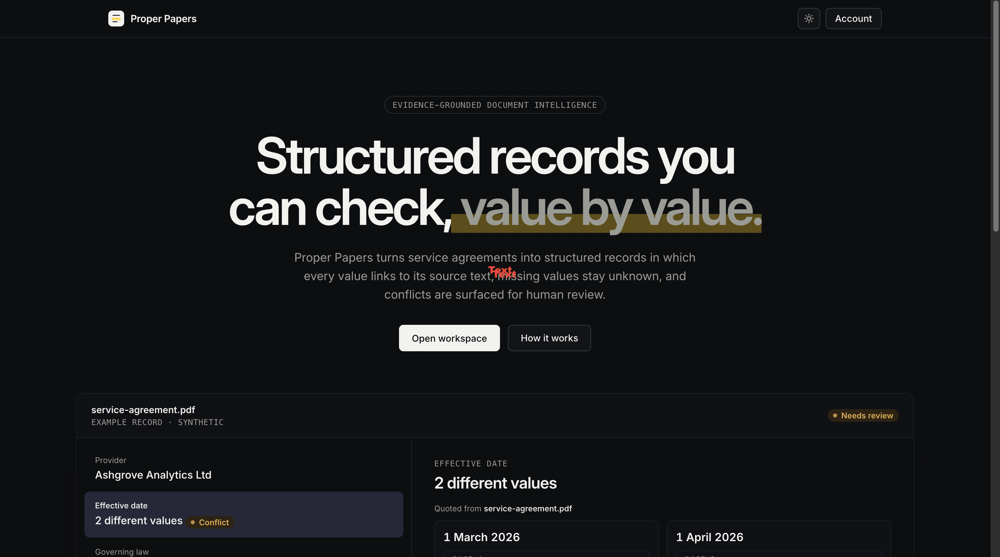
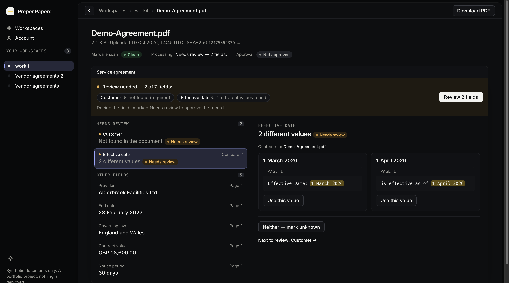
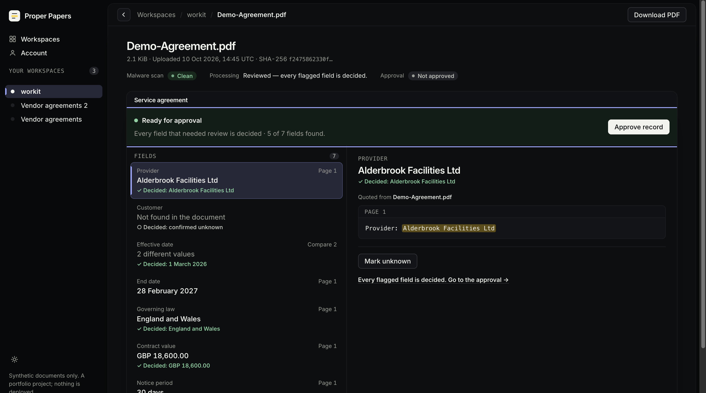

# Proper Papers

**Every claim has a source.** Evidence-grounded document intelligence.

Proper Papers turns service-agreement PDFs into structured, reviewable data. Every extracted value links back to the exact text in the document, so people can verify where it came from. Missing information stays unknown, conflicting information is flagged for human review, and approved records are saved as versioned JSON.

Built with Next.js, FastAPI and PostgreSQL, the system includes document scanning, isolated PDF processing, tenant-level data isolation and an evidence-based review workflow. It is a working portfolio project, not a production deployment.

> **Status:** extraction is rules-only at runtime. Model-assisted extraction was evaluated but is not enabled ([Evaluation](#evaluation)). The project is not production-ready and nothing is deployed ([Limits](#status-and-limits)).

## What is different about it

- **Evidence, UNKNOWN and conflicts are first-class.** Every found value carries quotes that equal the page text at their offsets (a violation fails the run). A missing value is UNKNOWN with a reason; disagreeing clauses become a conflict listing every candidate with its own quote. A reviewer picks an extracted candidate or UNKNOWN, with no free-text editing and no confidence scores.
- **Tenant isolation lives in the database.** Forced row-level security plus a membership check, and a runtime role the API refuses to use if it could bypass either.
- **Untrusted PDFs never run in the API.** Each document is parsed in a throwaway container with no network, a read-only root and resource limits, with no in-process fallback.
- **A negative evaluation result is reported.** Model assistance raised accuracy on a held-out split from 0.63 to 0.96, failed gates fixed in advance, and was therefore not enabled ([Evaluation](#evaluation)).

## Demo

Screenshots and a short recording of the real local application, using a synthetic document. [Watch the walkthrough](assets/demo/proper-papers-demo-1080p.mp4) (about 1 minute, no audio). [`docs/demo.md`](docs/demo.md) reproduces the whole flow locally on a disposable database with four synthetic documents.







## The workflow

| Step | What happens | Code |
|---|---|---|
| Upload | PDF only, size-capped, encrypted PDFs refused. Scanned with ClamAV before anything is stored; any scanner failure refuses the upload. | `documents.py`, `scanning.py` |
| Process | An explicit action. A run is queued in PostgreSQL; a worker parses the PDF in the sandbox and extracts the record with deterministic rules. | `worker.py`, `sandbox.py`, `apps/parser/`, `extraction/extract.py` |
| Review | Conflicts and missing required fields need a decision. | `review.py`, web document page |
| Approve | Freezes the run and the decisions into a new immutable version with a SHA-256. A later decision means "changed since version N"; approving again makes version N+1. | `review.py`, migration `0009` |
| Export | Returns the stored JSON of one version after re-checking its hash. | `review.py` |

(Paths under `apps/api/src/api/`.) Abridged field fragment from a real approved record for a synthetic document with two effective dates (`dev-c1-conflict-date`): the extractor reported a conflict, the reviewer chose the April reading, and the record keeps both facts.

```json
"effective_date": {
  "status": "found", "value": "2026-04-01", "basis": "reviewer_decision",
  "extracted": { "status": "conflict" },
  "decision": { "seq": 1, "decided_at": "2026-10-09T14:03:57+02:00" },
  "evidence": [{ "page": 1, "start": 147, "end": 178, "quote": "is effective as of 1 April 2026" }]
}
```

The same document has four fields it cannot support; they were approved as explicit unknowns.

## Architecture

```
Browser → Next.js server → FastAPI → PostgreSQL 18 (row-level security) ← worker → parser container
                              └→ ClamAV
```

Python 3.14 (FastAPI, SQLAlchemy, Alembic), Next.js App Router (TypeScript), PostgreSQL 18, pdfminer.six. Trade-offs are in [`docs/system-design.md`](docs/system-design.md). The choices that cost something:

- A Postgres job table with `FOR UPDATE SKIP LOCKED` and one worker, instead of a broker.
- One container per PDF with no in-process fallback; a production runner that does not need the Docker socket is a release blocker.
- Rules at runtime, because the model-assisted extractor failed its pre-registered gates.
- Row-level security keyed on session settings, which does not stop arbitrary SQL run as the runtime role (see [known gaps](docs/security.md#known-gaps)).

Deliberately left out: OCR, retrieval or vector search, a message broker, object storage, caching, rate limiting and hosting.

## Security and tenant isolation

A request sees a row only if its tenant matches and its user is a member. Tenants are created only by an operator CLI, the access token stays in a sealed HttpOnly cookie that only the server reads, and approved records cannot be updated or deleted, even by the runtime role. A review during development found that a role belonging to the owner role bypassed the first runtime-role guard and could read every tenant; the guard now checks role membership, and the regression tests fail against the old guard.

[`docs/security.md`](docs/security.md) lists each control with the code that enforces it and the tests that exercise it, plus the known gaps. There has been no external audit or penetration test.

## Evaluation

The corpus is 80 synthetic PDFs with ground truth: a dev split (22; the rules were written against it), three held-out splits (8, 16, 24) and a 10-case split for the model-assisted work. Held-out sets and pass/fail thresholds were committed before the extractor they judge was frozen. Method and tables: [`docs/evaluation.md`](docs/evaluation.md).

The rules extractor is exact on dev. On held-out data its field accuracy is 0.63–0.77 with no wrong values and abstention recall 1.0: it misses cases rather than inventing values.

A model-assisted extractor (the model proposes quoted spans for fields the rules left empty; each span is checked against the page text; the model cannot change a field the rules found) was measured twice. Worst of three runs against the rules on the same split:

| Held-out split | Field accuracy (rules → assisted) | Evidence completeness | Wrong values | Silent conflicts |
|---|---|---|---|---|
| `heldout-2`, 16 cases (assisted-1) | 0.6339 → 0.9643 | 0.3538 → 0.9385 | 0 → **2** | 1 → 1 |
| `heldout-3`, 24 cases (assisted-2) | 0.7679 → 0.9762 | 0.4459 → 0.9459 | 0 → 0 | 2 → **3** |

Each attempt failed a gate fixed in advance (wrong values, then silent conflicts), so the product stays rules-only. Nothing was tuned on held-out data and there was no third attempt. Every model response is committed and CI replays them (`make eval-assisted`, no API key, no model call). Mean cost was USD 0.0058 per call.

Limits: one author wrote the held-out documents and the extractors; the sets are small and more regular than real contracts. Read the numbers as directional.

## Verification

- **CI** (GitHub Actions, on every pull request and on `main`): API tests against real PostgreSQL, a real ClamAV engine and the real parser container; parser tests; web unit tests and a runtime check against the production build; `make eval`; the offline replay of both model evaluations. At the initial release commit all four jobs passed, with 1319 API tests (none skipped), 132 parser tests, 232 web unit tests and 260 runtime assertions.
- **Manual, local, 9 Oct 2026:** the full workflow in a browser against the real stack: upload and scan, queued versus not-processed, extraction against ground truth (7/7), conflict review, approval versions 1 and 2, an export whose SHA-256 matched the stored record, invalid uploads and other tenants' URLs refused, data intact after restarts. One session, not part of CI. The later review-flow and theme polish is covered by unit and runtime checks and was not walked through again.
- **Not verified:** a clean-clone run of the setup steps end to end; Safari, Firefox and screen-reader behaviour of the newest controls; cross-tenant access by a second signed-in user in a browser (isolation is tested at database and API level); load testing; any deployment.

## Run it

`make`, `uv`, Node 24 and Docker are required.

```sh
make api-setup web-setup parser-setup   # locked dependencies
make api-db-install api-db-up           # a disposable local PostgreSQL 18 (builds from source, once)
make check                              # parser, API and web checks; sandbox and real-scanner tests need Docker, the parser image and ClamAV, and are skipped without them (CI runs them all)
make eval                               # extraction evaluation through the real sandbox
```

Running the app interactively also needs a development OpenID Connect application (Auth0 was used); [`docs/demo.md`](docs/demo.md) lists the settings. Everything under `.local/` is gitignored, and test and demo commands only touch databases carrying a disposable marker. Component details: [`apps/api`](apps/api/README.md), [`apps/web`](apps/web/README.md), [`apps/parser`](apps/parser/README.md).

## Status and limits

- Not deployed. Hosting needs the API, database, worker and scanner, and a parser runner without the Docker socket. Required before any public deployment ([`docs/deployment-security.md`](docs/deployment-security.md)): rate limiting, HSTS, that runner, and scanner operations.
- One document type, seven fields, text PDFs only (no OCR). The extraction rules are specific to this domain.
- No four-eyes approval: the same person may decide and approve a record.
- Known security gaps: [`docs/security.md`](docs/security.md#known-gaps).

## Where to look in the code

- Evidence handling: `apps/api/src/api/extraction/contract.py` (`evidence_violations`), `apps/api/tests/test_extraction.py`.
- Isolation: `apps/api/migrations/versions/0002_tenants_rls.py`, `0004_workspace_membership_rls.py`, `apps/api/src/api/database.py`, `apps/api/tests/test_rls_isolation.py`.
- Sandbox: `apps/api/src/api/sandbox.py`, `apps/api/tests/test_parser_sandbox.py`.
- Review and immutability: `apps/api/src/api/review.py`, `apps/api/migrations/versions/0009_review.py`, `apps/api/tests/test_review_schema.py`.
- Evaluation: [`docs/evaluation.md`](docs/evaluation.md), `corpus/eval/`, `apps/api/scripts/eval_scoring.py`.

## About this repository

Proper Papers is an independent portfolio project, published as a curated source snapshot after development and validation in a private repository. The single initial commit does not represent the development history.

## Licence

MIT, copyright (c) 2026 Nova Zandkarimi. See [`LICENSE`](LICENSE) and [`NOTICE`](NOTICE), which lists third-party components under their own licences.
